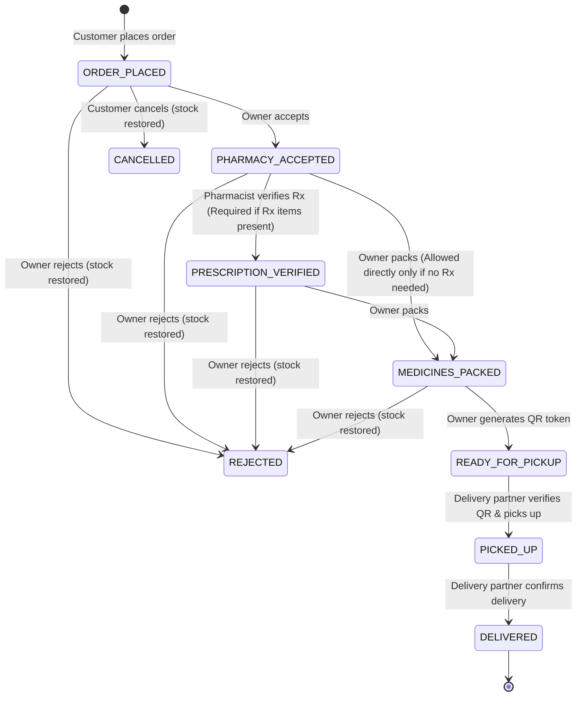

# MEDGO – Pharmacy Medicine Ordering, Prescription Management & Delivery Platform Backend

Backend API service for **MEDGO**, built with **Node.js**, **Express.js**, and **Supabase PostgreSQL**.

---

## Table of Contents
1. [Overview & Architecture](#overview--architecture)
2. [Project Structure](#project-structure)
3. [Technology Stack](#technology-stack)
4. [Environment Setup & Configuration](#environment-setup--configuration)
5. [Supabase Database & Storage Setup](#supabase-database--storage-setup)
6. [Running the Server](#running-the-server)
7. [Local Network & Flutter Integration](#local-network--flutter-integration)
8. [Demo Credentials & Sample Data](#demo-credentials--sample-data)
9. [Complete API Specification](#complete-api-specification)
10. [Order Status Lifecycle & Transitions](#order-status-lifecycle--transitions)
11. [Testing & Verification](#testing--verification)
12. [Common Integration Errors & Troubleshooting](#common-integration-errors--troubleshooting)

---

## Overview & Architecture

MEDGO is a medicine ordering, prescription management, and delivery platform designed for high security, prescription compliance, and clean separation of concerns.

### Key Architectural Tenets
- **Strict Response Contract**: Every endpoint returns `{ "success": true, "data": ... }` or `{ "success": false, "message": "..." }`.
- **Zero Frontend Price Trust**: All prices and order totals are calculated exclusively on the server using verified database records.
- **Strict Role-Based Access Control**:
  - `CUSTOMER`: Can register, browse pharmacies & medicines, upload prescriptions for their own patients, create orders, and cancel orders in `ORDER_PLACED` state.
  - `PHARMACY_OWNER`: Can accept/reject orders, verify prescriptions as a qualified pharmacist, mark orders packed, generate cryptographically secure one-time delivery QR tokens, toggle availability, and monitor live dashboard metrics.
  - `DELIVERY_PARTNER`: Demo partner identity separated from customer/owner roles (via `x-delivery-key` or delivery token), authorized to verify QR tokens, mark parcels picked up, and confirm deliveries.
- **Prescription Verification Barrier**: For medicines requiring a prescription, medicines cannot be packed or dispensed until verified by a qualified pharmacy owner.
- **Atomic Operations & Concurrency Safety**: PostgreSQL row locking and atomic stock deductions prevent inventory overselling. Stock is automatically restored if an order is cancelled or rejected.
- **Anti-Replay QR Tokens**: Delivery QR tokens are hashed with SHA-256, strictly one-time-use, time-limited, and store no patient medical data.

---

## Project Structure

```
medgo_backend/
├── .env.example                     # Environment variables template
├── package.json                     # Node.js project manifest & dependencies
├── server.js                        # Express server entry point (0.0.0.0:5000)
├── config/
│   ├── jwt.js                       # JWT configuration & expiration
│   └── supabase.js                  # Supabase client & storage bucket config
├── controllers/
│   ├── auth.controller.js           # Authentication controller (Register, Login, Me)
│   ├── delivery.controller.js       # Delivery QR verification & pickup/dropoff
│   ├── medicine.controller.js       # Medicine search & catalog controller
│   ├── order.controller.js          # Order placement, status updates, QR generation
│   ├── owner.controller.js          # Pharmacy owner dashboard, orders, availability
│   ├── pharmacy.controller.js       # Nearby pharmacies & pharmacy detail
│   └── prescription.controller.js   # Multer file upload & patient prescriptions
├── database/
│   ├── schema.sql                   # Complete PostgreSQL DDL (Tables, RLS, Procedures)
│   └── seed.sql                     # Fictional demonstration seed dataset
├── middleware/
│   ├── auth.middleware.js           # JWT Bearer token validator
│   ├── error.middleware.js          # Centralized error handler & status codes
│   └── role.middleware.js           # Role-based access control (RBAC)
├── routes/
│   ├── auth.routes.js               # /api/v1/auth routes
│   ├── delivery.routes.js           # /api/v1/delivery routes
│   ├── medicine.routes.js           # /api/v1/medicines routes
│   ├── order.routes.js              # /api/v1/orders routes
│   ├── owner.routes.js              # /api/v1/owner routes
│   ├── pharmacy.routes.js           # /api/v1/pharmacies routes
│   └── prescription.routes.js       # /api/v1/prescriptions routes
├── services/
│   ├── auth.service.js              # User auth logic & password hashing
│   ├── delivery.service.js          # QR token verification & transition timestamps
│   ├── order.service.js             # Atomic order creation & status transitions
│   └── prescription.service.js      # Storage image upload & patient privacy checks
├── tests/
│   ├── mockSupabase.js              # In-memory PostgREST mock client for hermetic CI tests
│   └── api.test.js                  # 34-test end-to-end integration test suite
└── utils/
    ├── generateToken.js             # JWT signing utility
    ├── response.js                  # Standardized response envelopes (sendSuccess, sendError)
    └── validators.js                # Zod schemas for input validation
```

---

## Technology Stack

- **Runtime**: Node.js (`>=18.0.0`)
- **Web Framework**: Express.js (`4.21.x`)
- **Database**: Supabase PostgreSQL with `@supabase/supabase-js`
- **Authentication**: JSON Web Tokens (`jsonwebtoken`) & `bcryptjs`
- **File Uploads**: `multer` (in-memory buffer processing) & Supabase Storage
- **Validation**: `zod`
- **Security & Utilities**: `cors`, `dotenv`, `express-rate-limit`, `uuid`
- **Testing**: Node.js built-in test runner (`node:test`, `node:assert/strict`) & `supertest`

---

## Environment Setup & Configuration

1. In the `medgo_backend/` folder (or project root), copy `.env.example` to `.env`:
   ```bash
   cp medgo_backend/.env.example medgo_backend/.env
   ```

2. Configure environment variables in `medgo_backend/.env`:
   ```ini
   PORT=5000
   SUPABASE_URL=https://your-project-id.supabase.co
   SUPABASE_SERVICE_ROLE_KEY=your-supabase-service-role-key-here
   JWT_SECRET=your_super_secret_jwt_key_here
   JWT_EXPIRES_IN=7d
   SUPABASE_STORAGE_BUCKET=prescriptions
   DELIVERY_API_KEY=medgo-delivery-demo-key-2026
   NODE_ENV=development
   ```

> [!WARNING]
> Never commit your `.env` file or expose `SUPABASE_SERVICE_ROLE_KEY` to the Flutter client. The service role key bypasses Row Level Security and must remain on the backend server only.

---

## Supabase Database & Storage Setup

### 1. Database Schema
1. Open your Supabase Dashboard: `https://supabase.com/dashboard/project/<your-project-id>`.
2. Navigate to the **SQL Editor**.
3. Open `medgo_backend/database/schema.sql`.
4. Copy the entire contents and run it in the SQL Editor.
   - This creates all 9 tables (`users`, `pharmacies`, `medicines`, `patients`, `prescriptions`, `prescription_items`, `orders`, `order_items`, `deliveries`).
   - Enables Row Level Security (RLS) policies.
   - Creates indexes on foreign keys, email, and locations.
   - Creates the PostgreSQL stored procedures: `create_order_with_items_and_stock` and `restore_order_stock_atomic`.

### 2. Storage Bucket Setup
1. In the Supabase Dashboard, go to **Storage**.
2. Create a new bucket named: `prescriptions`.
3. Set the bucket as **Private** (or Public with signed URLs for controlled preview).
4. Ensure your `SUPABASE_SERVICE_ROLE_KEY` has read/write privileges to this bucket.

### 3. Seed Demonstration Data
1. In the Supabase SQL Editor, open `medgo_backend/database/seed.sql`.
2. Run the script to populate demo customers, pharmacy owners, pharmacies, medicines, patients, and sample prescriptions.

---

## Running the Server

### Installation
From the root workspace or `medgo_backend`:
```bash
npm install --prefix medgo_backend
```

### Start Server in Production/Development Mode
```bash
npm start
# OR from inside medgo_backend:
cd medgo_backend && npm start
```

### Live Reloading (Development)
```bash
npm run dev
```

The server binds to `0.0.0.0:5000`.
- API Base URL: `http://localhost:5000/api/v1`
- Health check: `http://localhost:5000/health` or `http://localhost:5000/api/v1/health`

---

## Local Network & Flutter Integration

For testing with a physical device or emulator/simulator:
- **Android Emulator**: Access the backend via `http://10.0.2.2:5000/api/v1`.
- **iOS Simulator**: Access via `http://127.0.0.1:5000/api/v1`.
- **Physical Device**: Find your machine's local IP address (`ipconfig` on Windows or `ifconfig` on macOS/Linux), e.g., `http://192.168.1.50:5000/api/v1`.
- CORS is enabled with wildcard `*` headers to support local Flutter testing without origin blocking.

---

## Demo Credentials & Sample Data

All demo passwords are: **`123456`**

| Role | Name | Email | Phone | Notes |
| :--- | :--- | :--- | :--- | :--- |
| **CUSTOMER** | Arun Kumar | `arun@gmail.com` | `9876543210` | Owns patient `PAT1001` |
| **CUSTOMER** | Priya Sharma | `priya@gmail.com` | `9876543212` | Owns patient `PAT1002` |
| **PHARMACY_OWNER** | Ramesh | `ramesh@gmail.com` | `9876543211` | Owns **Sri Medicals** |
| **PHARMACY_OWNER** | Suresh Patel | `suresh@gmail.com` | `9876543214` | Owns **City Pharmacy** & **HealthCare Medicals** |
| **DELIVERY_PARTNER** | Demo Delivery | Simulator Key | `Header: x-delivery-key` | `medgo-delivery-demo-key-2026` |

### Sample Pharmacies & Medicines

#### 1. Sri Medicals (`c1111111-1111-1111-1111-111111111111`) - Owner: Ramesh
- **Paracetamol 500mg** (`11111111-0000-0000-0000-000000000001`): Price ₹25.00, Stock: 100, Rx Required: `false`
- **Amoxicillin 500mg** (`11111111-0000-0000-0000-000000000002`): Price ₹85.00, Stock: 50, Rx Required: `true`
- **Cetirizine 10mg** (`11111111-0000-0000-0000-000000000003`): Price ₹35.00, Stock: 80, Rx Required: `false`
- **Pantoprazole 40mg** (`11111111-0000-0000-0000-000000000004`): Price ₹65.00, Stock: 60, Rx Required: `false`

#### 2. City Pharmacy (`c2222222-2222-2222-2222-222222222222`) - Owner: Suresh Patel
- **Paracetamol 500mg** (`22222222-0000-0000-0000-000000000001`): Price ₹24.00, Stock: 120, Rx Required: `false`
- **Azithromycin 500mg** (`22222222-0000-0000-0000-000000000002`): Price ₹120.00, Stock: 40, Rx Required: `true`
- **Metformin 500mg** (`22222222-0000-0000-0000-000000000003`): Price ₹45.00, Stock: 90, Rx Required: `true`

---

## Complete API Specification

Standard Response Format:
```json
// Success (200, 201)
{
  "success": true,
  "data": { ... }
}

// Error (400, 401, 403, 404, 409, 500)
{
  "success": false,
  "message": "Error description"
}
```

---

### 1. Authentication Endpoints

#### Register
- **Endpoint**: `POST /api/v1/auth/register`
- **Auth**: None
- **Request**:
  ```json
  {
    "name": "Arun Kumar",
    "email": "arun@gmail.com",
    "phone": "9876543210",
    "password": "123456",
    "role": "CUSTOMER"
  }
  ```
- **Response (201 Created)**:
  ```json
  {
    "success": true,
    "data": {
      "user": {
        "id": "a1111111-1111-1111-1111-111111111111",
        "name": "Arun Kumar",
        "email": "arun@gmail.com",
        "phone": "9876543210",
        "role": "CUSTOMER"
      }
    }
  }
  ```

#### Login
- **Endpoint**: `POST /api/v1/auth/login`
- **Auth**: None
- **Request**:
  ```json
  {
    "email": "arun@gmail.com",
    "password": "123456"
  }
  ```
- **Response (200 OK)**:
  ```json
  {
    "success": true,
    "data": {
      "token": "eyJhbGciOiJIUzI1NiIsInR5cCI6IkpXVCJ9...",
      "user": {
        "id": "a1111111-1111-1111-1111-111111111111",
        "name": "Arun Kumar",
        "email": "arun@gmail.com",
        "role": "CUSTOMER"
      }
    }
  }
  ```

#### Get Current User
- **Endpoint**: `GET /api/v1/auth/me`
- **Auth**: `Authorization: Bearer <JWT_TOKEN>`
- **Response (200 OK)**:
  ```json
  {
    "success": true,
    "data": {
      "user": {
        "id": "a1111111-1111-1111-1111-111111111111",
        "name": "Arun Kumar",
        "email": "arun@gmail.com",
        "phone": "9876543210",
        "role": "CUSTOMER"
      }
    }
  }
  ```

---

### 2. Pharmacy Endpoints

#### Get Nearby Pharmacies
- **Endpoint**: `GET /api/v1/pharmacies?lat=9.9252&lng=78.1198&radius_km=5`
- **Auth**: None
- **Response (200 OK)**:
  ```json
  {
    "success": true,
    "data": [
      {
        "id": "c1111111-1111-1111-1111-111111111111",
        "name": "Sri Medicals",
        "owner_name": "Ramesh",
        "address": "Anna Nagar, Madurai",
        "latitude": 9.9252,
        "longitude": 78.1198,
        "distance_km": 0,
        "is_open": true,
        "opening_time": "09:00",
        "closing_time": "22:00",
        "phone": "9876543210"
      }
    ]
  }
  ```

#### Get Pharmacy Details
- **Endpoint**: `GET /api/v1/pharmacies/:id`
- **Auth**: None
- **Response (200 OK)**:
  ```json
  {
    "success": true,
    "data": {
      "id": "c1111111-1111-1111-1111-111111111111",
      "name": "Sri Medicals",
      "owner_name": "Ramesh",
      "address": "Anna Nagar, Madurai",
      "latitude": 9.9252,
      "longitude": 78.1198,
      "phone": "9876543210",
      "opening_time": "09:00",
      "closing_time": "22:00",
      "is_open": true
    }
  }
  ```

---

### 3. Medicine Endpoints

#### Search Medicines
- **Endpoint**: `GET /api/v1/medicines?search=paracetamol&pharmacy_id=c1111111-1111-1111-1111-111111111111`
- **Auth**: None
- **Response (200 OK)**:
  ```json
  {
    "success": true,
    "data": [
      {
        "id": "11111111-0000-0000-0000-000000000001",
        "pharmacy_id": "c1111111-1111-1111-1111-111111111111",
        "name": "Paracetamol 500mg",
        "price": 25,
        "stock": 100,
        "requires_prescription": false
      }
    ]
  }
  ```

---

### 4. Prescription Endpoints

#### Upload Prescription
- **Endpoint**: `POST /api/v1/prescriptions`
- **Auth**: `Authorization: Bearer <CUSTOMER_JWT>`
- **Content-Type**: `multipart/form-data`
- **Body**:
  - `patient_id`: `"PAT1001"` (or patient UUID)
  - `image`: Image file (JPG, JPEG, PNG, max 5MB)
- **Response (201 Created)**:
  ```json
  {
    "success": true,
    "data": {
      "id": "e1111111-1111-1111-1111-111111111111",
      "patient_id": "PAT1001",
      "image_url": "https://demo-storage.supabase.co/prescriptions/...",
      "status": "PENDING"
    }
  }
  ```

#### Get Patient Prescriptions
- **Endpoint**: `GET /api/v1/patients/:patientId/prescriptions`
- **Auth**: `Authorization: Bearer <JWT_TOKEN>` (Customer who owns patient or Pharmacy Owner with order)
- **Response (200 OK)**:
  ```json
  {
    "success": true,
    "data": [
      {
        "id": "e1111111-1111-1111-1111-111111111111",
        "patient_id": "PAT1001",
        "doctor_name": "Dr. Kumar",
        "medicines": [
          {
            "name": "Paracetamol 500mg",
            "quantity": 10
          }
        ],
        "status": "PENDING"
      }
    ]
  }
  ```

#### Update Prescription Status
- **Endpoint**: `PATCH /api/v1/prescriptions/:id/status`
- **Auth**: `Authorization: Bearer <OWNER_JWT>`
- **Request**:
  ```json
  {
    "status": "VERIFIED"
  }
  ```
- **Response (200 OK)**:
  ```json
  {
    "success": true,
    "data": {
      "id": "e1111111-1111-1111-1111-111111111111",
      "status": "VERIFIED",
      "image_url": "..."
    }
  }
  ```

---

### 5. Order Endpoints

#### Create Order
- **Endpoint**: `POST /api/v1/orders`
- **Auth**: `Authorization: Bearer <CUSTOMER_JWT>`
- **Request**:
  ```json
  {
    "pharmacy_id": "c1111111-1111-1111-1111-111111111111",
    "prescription_id": "e1111111-1111-1111-1111-111111111111",
    "items": [
      {
        "medicine_id": "11111111-0000-0000-0000-000000000001",
        "quantity": 2
      }
    ]
  }
  ```
- **Response (201 Created)**:
  ```json
  {
    "success": true,
    "data": {
      "id": "order-uuid",
      "status": "ORDER_PLACED",
      "total_amount": 50,
      "pharmacy_id": "c1111111-1111-1111-1111-111111111111"
    }
  }
  ```

#### Get Order Details
- **Endpoint**: `GET /api/v1/orders/:id`
- **Auth**: `Authorization: Bearer <JWT_TOKEN>` (Customer or Pharmacy Owner)
- **Response (200 OK)**:
  ```json
  {
    "success": true,
    "data": {
      "id": "order-uuid",
      "status": "ORDER_PLACED",
      "total_amount": 50,
      "pharmacy_name": "Sri Medicals",
      "items": [
        {
          "id": "item-uuid",
          "medicine_id": "11111111-0000-0000-0000-000000000001",
          "medicine_name": "Paracetamol 500mg",
          "quantity": 2,
          "price": 25.00
        }
      ]
    }
  }
  ```

#### Update Order Status
- **Endpoint**: `PATCH /api/v1/orders/:id/status`
- **Auth**: `Authorization: Bearer <JWT_TOKEN>`
- **Request**:
  ```json
  {
    "status": "PHARMACY_ACCEPTED"
  }
  ```
- **Response (200 OK)**:
  ```json
  {
    "success": true,
    "data": {
      "id": "order-uuid",
      "status": "PHARMACY_ACCEPTED",
      "total_amount": 50,
      "pharmacy_id": "c1111111-1111-1111-1111-111111111111"
    }
  }
  ```

#### Generate Parcel QR Token
- **Endpoint**: `POST /api/v1/orders/:id/qr`
- **Auth**: `Authorization: Bearer <OWNER_JWT>`
- **Response (200 OK)**:
  ```json
  {
    "success": true,
    "data": {
      "qr_token": "a1b2c3d4e5f6...",
      "order_id": "order-uuid",
      "status": "READY_FOR_PICKUP"
    }
  }
  ```

---

### 6. Delivery Endpoints

#### Verify QR Token
- **Endpoint**: `POST /api/v1/delivery/verify`
- **Auth**: `x-delivery-key: medgo-delivery-demo-key-2026` (or delivery Bearer token)
- **Request**:
  ```json
  {
    "qr_token": "a1b2c3d4e5f6..."
  }
  ```
- **Response (200 OK)**:
  ```json
  {
    "success": true,
    "data": {
      "order_id": "order-uuid",
      "pharmacy_name": "Sri Medicals",
      "status": "READY_FOR_PICKUP",
      "verified": true
    }
  }
  ```

#### Update Delivery Status
- **Endpoint**: `PATCH /api/v1/delivery/:orderId/status`
- **Auth**: `x-delivery-key: medgo-delivery-demo-key-2026` (or delivery Bearer token)
- **Request**:
  ```json
  {
    "status": "PICKED_UP"
  }
  // Later:
  {
    "status": "DELIVERED"
  }
  ```
- **Response (200 OK)**:
  ```json
  {
    "success": true,
    "data": {
      "order_id": "order-uuid",
      "status": "PICKED_UP"
    }
  }
  ```

---

### 7. Owner Endpoints

#### Owner Dashboard
- **Endpoint**: `GET /api/v1/owner/dashboard`
- **Auth**: `Authorization: Bearer <OWNER_JWT>`
- **Response (200 OK)**:
  ```json
  {
    "success": true,
    "data": {
      "new_orders": 2,
      "accepted_orders": 3,
      "preparing_orders": 1,
      "completed_orders": 10
    }
  }
  ```

#### Owner Orders
- **Endpoint**: `GET /api/v1/owner/orders`
- **Auth**: `Authorization: Bearer <OWNER_JWT>`
- **Response (200 OK)**:
  ```json
  {
    "success": true,
    "data": [
      {
        "id": "order-uuid",
        "customer_name": "Arun Kumar",
        "pharmacy_id": "c1111111-1111-1111-1111-111111111111",
        "prescription_id": "e1111111-1111-1111-1111-111111111111",
        "items": [
          {
            "medicine_id": "11111111-0000-0000-0000-000000000001",
            "medicine_name": "Paracetamol 500mg",
            "quantity": 2,
            "price": 25.00
          }
        ],
        "total_amount": 50,
        "status": "ORDER_PLACED",
        "created_at": "2026-11-16T16:00:00.000Z"
      }
    ]
  }
  ```

#### Update Pharmacy Availability
- **Endpoint**: `PATCH /api/v1/owner/pharmacy/availability`
- **Auth**: `Authorization: Bearer <OWNER_JWT>`
- **Request**:
  ```json
  {
    "is_open": true
  }
  ```
- **Response (200 OK)**:
  ```json
  {
    "success": true,
    "data": {
      "id": "c1111111-1111-1111-1111-111111111111",
      "name": "Sri Medicals",
      "is_open": true
    }
  }
  ```

---

## Order Status Lifecycle & Transitions



### Exact Status Strings
- `ORDER_PLACED`
- `PHARMACY_ACCEPTED`
- `PRESCRIPTION_VERIFIED`
- `MEDICINES_PACKED`
- `READY_FOR_PICKUP`
- `PICKED_UP`
- `DELIVERED`
- `REJECTED`
- `CANCELLED`

---

## Testing & Verification

The backend includes a comprehensive 35-test integration suite covering all required positive and negative user stories.

Run the test suite:
```bash
npm test
```

### Test Results Summary
```
▶ MEDGO Complete Backend End-to-End Test Suite
  ✔ 1. Customer registration - POST /api/v1/auth/register
  ✔ 2. Customer login - POST /api/v1/auth/login
  ✔ 3. Pharmacy owner login - POST /api/v1/auth/login
  ✔ 4. Get current user - GET /api/v1/auth/me
  ✔ 5. Retrieve nearby pharmacies - GET /api/v1/pharmacies
  ✔ 6. Get pharmacy details - GET /api/v1/pharmacies/:id
  ✔ 7. Search medicines - GET /api/v1/medicines
  ✔ 8. Upload prescription - POST /api/v1/prescriptions
  ✔ 9. Retrieve patient prescriptions - GET /api/v1/patients/:patientId/prescriptions
  ✔ 10. Create order - POST /api/v1/orders
  ✔ 11. Owner retrieves incoming orders - GET /api/v1/owner/orders
  ✔ 12. Owner accepts order - PATCH /api/v1/orders/:id/status
  ✔ 13. Owner verifies prescription - PATCH /api/v1/prescriptions/:id/status & order
  ✔ 14. Owner marks medicines packed - PATCH /api/v1/orders/:id/status
  ✔ 15. Generate parcel QR token - POST /api/v1/orders/:id/qr
  ✔ 16. Delivery partner verifies QR - POST /api/v1/delivery/verify
  ✔ 17. Delivery partner marks pickup - PATCH /api/v1/delivery/:orderId/status
  ✔ 18. Delivery partner marks delivered - PATCH /api/v1/delivery/:orderId/status
  ✔ 19. Customer retrieves final order status - GET /api/v1/orders/:id
  ✔ 20. Wrong password returns 401
  ✔ 21. Duplicate email returns 409
  ✔ 22. Missing JWT returns 401
  ✔ 23. Customer accessing owner dashboard returns 403
  ✔ 24. Customer accessing another customer patient records returns 403
  ✔ 25. Unauthorized order access returns 403
  ✔ 26. Invalid medicine ID returns 404
  ✔ 27. Insufficient stock returns 400
  ✔ 28. Invalid status transition returns 400
  ✔ 29. Expired QR token returns 400
  ✔ 30. Reused QR token returns 400 (replay attack prevented)
  ✔ 31. Owner updates pharmacy availability - PATCH /api/v1/owner/pharmacy/availability
  ✔ 32. Owner dashboard metrics - GET /api/v1/owner/dashboard
  ✔ 33. Order cancellation restores stock
  ✔ 34. Health check endpoint - GET /health & /api/v1/health
ℹ tests 35, pass 35, fail 0
```

---

## Common Integration Errors & Troubleshooting

1. **401 Unauthorized (`Authorization token required in Bearer format`)**:
   - Ensure the `Authorization` header is sent as `Bearer <token>` with a single space.
2. **403 Forbidden (`Access forbidden: requires one of the following roles`)**:
   - Check the role of the user inside the JWT token. Customer endpoints reject `PHARMACY_OWNER`, and owner endpoints reject `CUSTOMER`.
3. **400 Invalid status transition**:
   - Strict transition rules apply. You cannot jump directly from `ORDER_PLACED` to `DELIVERED`, or pack medicines before prescription verification when prescription medicines are present.
4. **400 QR token has already been redeemed**:
   - Once a parcel token is validated by the delivery simulator, it cannot be reused (anti-replay defense). Generate a new token if re-testing.
5. **Connection refused on Android emulator**:
   - Do not use `localhost` in Flutter when running on an Android emulator; use `10.0.2.2:5000`.
